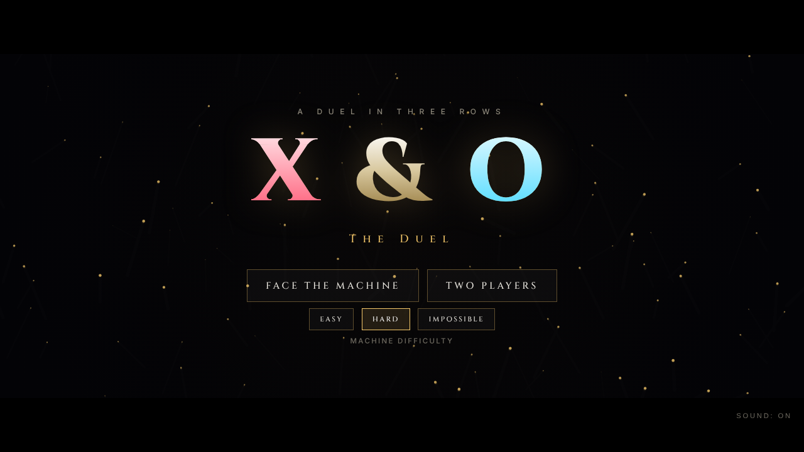
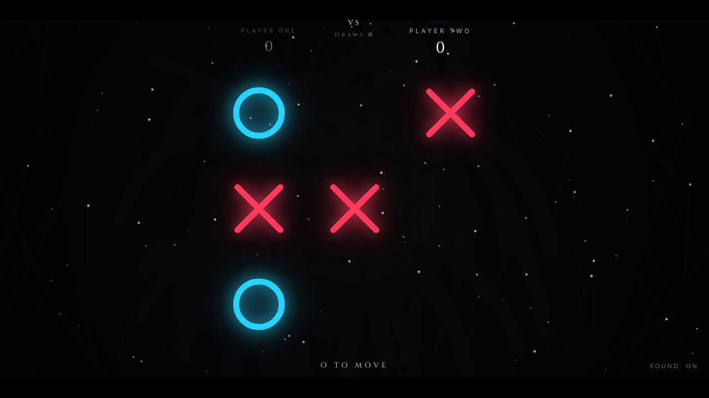

# X & O — The Duel

A cinematic tic-tac-toe game in a single HTML file.

**[▶ Play it live](https://cinematic-x-and-o.vercel.app)**

  
  

- Film-grain, letterbox bars, drifting gold particles
- Neon X and O marks that draw themselves in
- Slow-motion win beat, light flash, screen shake and spark bursts
- Synthesized soundtrack and effects (Web Audio, no assets)
- Play the Machine (Easy / Hard / Impossible minimax AI) or two players locally
- Keyboard: number pad 1–9 to place, Enter for next round

## Play

Play it at [cinematic-x-and-o.vercel.app](https://cinematic-x-and-o.vercel.app), or open `index.html` in a browser.
